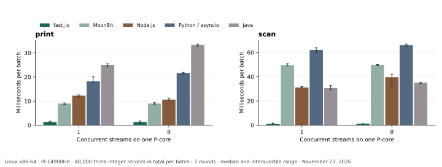
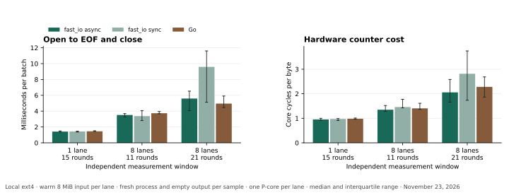
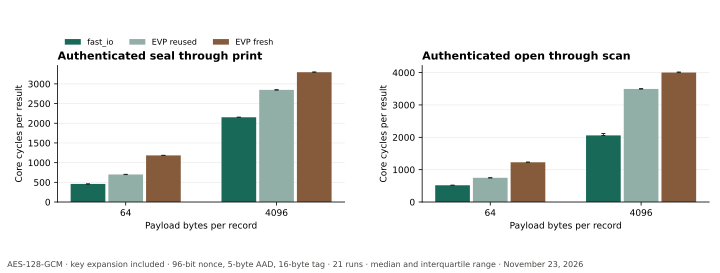

# Linux x86-64 I/O measurements, November 23, 2026

The machine used an Intel Core i9-14900HX and Linux 6.17.0-29. All builds, native measurements and guest correctness runs shared a 16 GiB cgroup with zero swap. The previous version denotes a snapshot of the local working tree taken before this round. The timing figures show medians with the first and third quartiles across independent rounds. [Figure data](medians.csv)

## Record output and input

Each batch opens the files, writes or scans three integer fields per record and closes the files. The runner verifies output hashes and the scan checks field values and EOF. The timed batches follow one warm-up. One and eight lanes share the same physical-core budget. The first experiment uses 160,000 records across the batch. The second uses 48,000 and includes separate runtimes. Compare implementations within the same panel.

Wall time and issuer occupancy describe different costs. For one stream, fast_io printed 47.77 million records/s against 31.60 for Go and 19.74 for Tokio. Joining fast_io after creating the 160,000-record batch took the total time from 0.803 ms at submission return to 3.277 ms at completion. The issuing thread consumed 1.998 ms of CPU over that interval. Go returned in 0.006 ms, completed in 4.834 ms and consumed 0.024 ms on the issuing thread. Tokio returned in 0.003 ms, completed in 7.755 ms and consumed 5.784 ms on its issuer. These are batch measurements. A runtime that hands work to another thread can return to its caller sooner. The previous fast_io snapshot reached 48.48 million records/s for single-stream print and 48.00 for eight-stream print, compared with 44.97 for the current eight-stream run.

Single-stream scan reached 45.55 million records/s for fast_io, 45.29 for the previous snapshot, 28.54 for Tokio and 6.20 for Go. In a separate 16,000-record run, upstream fast_io issued three single-field waits per record. It reached 23.99 million records/s versus 46.81 for the three-field public call here. With eight streams the respective rates were 19.59 and 32.94 million.

## Constructed and in-place values

The returning-value fixture waits for the producer's selected start, checks for actual suspension, then joins the value. Both Rust cases exercise the same observable work with different ownership. The current fast_io result used 116.16 core cycles and 21.90 ns. The pinned Rust future used 119.33 cycles and 21.86 ns. Code layout, frequency and instructions per cycle affect the ordering on these two metrics. With no subscription, fast_io used 43.98 cycles and the ready Rust future used 52.78. A target-only, unsubscribed in-place operation used 58.88 cycles in fast_io versus 57.97 in Rust.

## Named ext4 file transfer

Each lane copies a warm 8 MiB input into an empty ext4 file in a fresh process. Timing covers open through EOF and close. The harness verifies the output and calls fsync outside the timed interval. Eight lanes have eight P-cores available. The single-lane medians were 5.510 GiB/s for fast_io async, 5.445 for fast_io sync and 5.366 for Go. The first eight-lane window favored fast_io async, 17.788 versus 16.723 GiB/s. The independent confirmation favored Go, 12.621 versus 11.179 GiB/s.

Both implementations kept the file payload in the kernel. VTune sampled the same x86 instruction in the kernel memcpy routine, a repeated byte move in arch/x86/lib/memcpy_64.S at line 38. It accounted for 45.68% of fast_io’s kernel cycle weight and 49.33% of Go’s. Clearing pages accounted for 24.71% and 16.45%, respectively. The fast_io pipeline used sendfile and splice. Go used copy_file_range. These measurements include filesystem and kernel scheduling effects.

## UTF and authenticated values

For 16 random mixed UTF-16 scalars, avoiding an unnecessary output allocation during finish reduced the full decorated print path from 127.68 to 61.69 core cycles with Clang and from 134.97 to 67.75 with GCC. The figure also shows the narrower one-step simdutf conversion as an algorithm reference. The fast_io call includes construction of the stream decorator, field output and checked finish.

The AES-128-GCM value fixture times key expansion on each record. It checks sealing against EVP and verifies that a wrong tag leaves the scan destination intact. On a 4096-byte input the runtime-sized fast_io seal used 2,152 cycles and the verified scan used 2,059. Reusing the OpenSSL 4.1.0 EVP context gave 2,848 and 3,495 cycles. The EVP open fixture decrypts to a private buffer before publishing and erases that buffer afterward. The fast_io path authenticates the ciphertext before decrypting into the destination.

## Frontend and regression coverage

The four-operation translation unit covers an ordinary and a marked call path. GCC 11–17 and Clang 17–24 supplied 48 accepted compiler and language-mode combinations, including two distinct Clang 24 frontends and locally built development compilers. Deferring two UTF table instantiations reduced median synchronous compile CPU time by 8.96% among GCC configurations and 3.15% among Clang configurations relative to an otherwise identical eager build. All 96 stripped executable pairs had identical SHA-256 digests. Relative to the earlier full working-tree baseline, all 48 synchronous executables retained their size. Among 42 comparable marked builds, three shrank and 39 retained their size. Six previously failing GCC 11–13 marked configurations built and ran.

Four ABI configurations ran the TLS protocol and authentication regressions. Each ran a 900-second random record and session workload. The C++ exception, pure Herbceptions and dual builds checked rejection before plaintext publication. The exception-disabled build checked valid opening and used separate termination tests for failure. The pure Herbceptions run rejected 501,023,556 records and completed 244,642 independent sessions. Format testing compared 3,181 results per ABI. The operand-lifetime and semantic-manipulator campaigns each checked one million generated cases per ABI.
