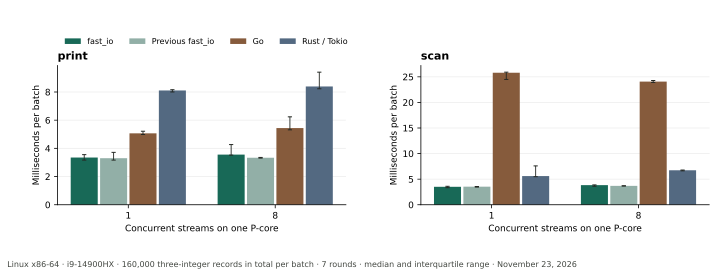
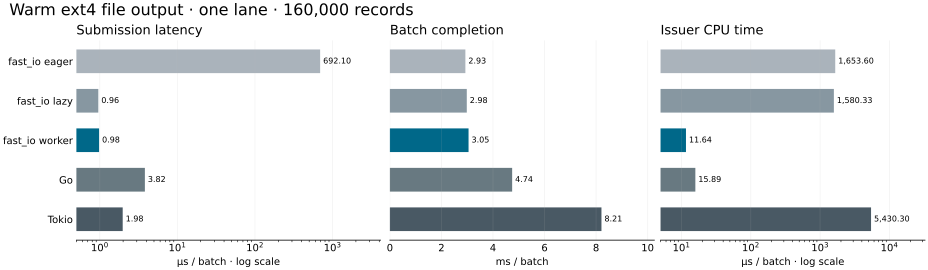
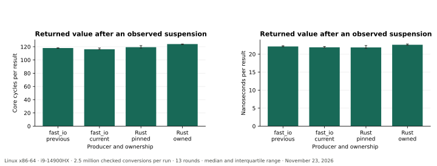
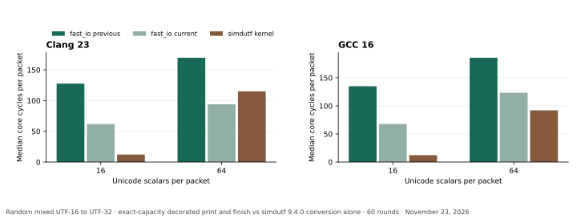
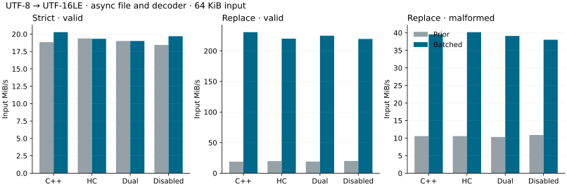
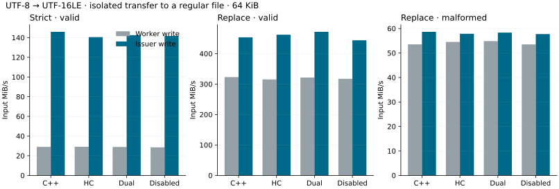

# Linux x86-64 I/O measurements, November 23, 2026

The machine used an Intel Core i9-14900HX and Linux 6.17.0-29. All builds, native measurements and guest correctness runs shared a 16 GiB cgroup with zero swap. The previous version denotes a snapshot of the local working tree taken before this round. The timing figures show medians with the first and third quartiles across independent rounds. [Figure data](medians.csv)

## Record output and input

Each batch opens the files, writes or scans three integer fields per record and closes the files. The runner verifies output hashes and the scan checks field values and EOF. The timed batches follow one warm-up. One and eight lanes share the same physical-core budget. The first experiment uses 160,000 records across the batch. The second uses 48,000 and includes separate runtimes. Compare implementations within the same panel.

The earlier eager-open fixture measured wall time and issuer occupancy separately. For one stream, fast_io printed 47.77 million records/s against 31.60 for Go and 19.74 for Tokio. Joining fast_io after creating the 160,000-record batch took the total time from 0.803 ms at submission return to 3.277 ms at completion. The issuing thread consumed 1.998 ms of CPU over that interval. Go returned in 0.006 ms, completed in 4.834 ms and consumed 0.024 ms on the issuing thread. Tokio returned in 0.003 ms, completed in 7.755 ms and consumed 5.784 ms on its issuer. These are batch measurements. A runtime that hands work to another thread can return to its caller sooner. The previous fast_io snapshot reached 48.48 million records/s for single-stream print and 48.00 for eight-stream print, compared with 44.97 for the current eight-stream run.

Single-stream scan reached 45.55 million records/s for fast_io, 45.29 for the previous snapshot, 28.54 for Tokio and 6.20 for Go. In a separate 16,000-record run, upstream fast_io issued three single-field waits per record. It reached 23.99 million records/s versus 46.81 for the three-field public call here. With eight streams the respective rates were 19.59 and 32.94 million.

## Moving file open and formatting off the issuer

The follow-up compares five implementations on one pinned P-core. Each process writes 160,000 records across one or eight ext4 files. The final bytes of each file are checked with SHA-256. Warm batches reuse the issuer and repeat the truncate, write and close sequence. A separate group measures the first batch in a fresh process. There are 15 interleaved trials for every combination. The figure shows medians for the warm single-lane group. The first and third panels use logarithmic axes to show both microsecond submissions and millisecond-scale issuer work. [All twenty combinations](print-handoff.csv)

The reusable fast_io worker submitted a warm batch in 0.98 µs and completed it in 3.052 ms, using 11.64 µs of issuer CPU. Go measured 3.82 µs, 4.744 ms and 15.89 µs. Tokio measured 1.98 µs, 8.209 ms and 5,430.30 µs. Tokio drove its executor on the issuing thread. Moving the open into a lazy fast_io root alone reduced submission to 0.96 µs but still required 1,580.33 µs of issuer CPU. The eager fast_io fixture completed in 2.929 ms. Creating the fast_io worker on its first batch cost 62.02 µs to submit, against 1.80 µs for Go and 1.58 µs for Tokio, whose runtimes were already initialized at the measurement boundary.

A separate scan experiment checks all three integer values in every record and checks EOF. The worker finished in 1.619 ms for one lane and 2.130 ms for eight lanes. The eager snapshot measured 1.515 ms and 1.639 ms respectively. Eight lanes share the same pinned CPU. [Scan comparison, including Go and Tokio](scan-handoff.csv)

A second, independently timed experiment kept the reusable worker and changed the copy of a five-byte array snapshot. Clang emitted four load/store instructions in place of ten. Actual whole-process cycles per record fell from 47.18 to 45.32 for one lane and from 58.13 to 56.12 for eight lanes. The benchmark text section shrank by 96 bytes. The stripped ELF occupied 89,008 bytes in both builds. VTune attributed 21.5% of P-core pipeline slots to front-end stalls. In the kernel sample, page clearing accounted for 13.78% of kernel cycle weight and user copying accounted for 4.72%.

## Constructed and in-place values

The returning-value fixture waits for the producer's selected start, checks for actual suspension, then joins the value. Both Rust cases exercise the same observable work with different ownership. The current fast_io result used 116.16 core cycles and 21.90 ns. The pinned Rust future used 119.33 cycles and 21.86 ns. Code layout, frequency and instructions per cycle affect the ordering on these two metrics. With no subscription, fast_io used 43.98 cycles and the ready Rust future used 52.78. A target-only, unsubscribed in-place operation used 58.88 cycles in fast_io versus 57.97 in Rust.

## Named ext4 file transfer

Each lane copies a warm 8 MiB input into an empty ext4 file in a fresh process. Timing covers open through EOF and close. The harness verifies the output and calls fsync outside the timed interval. Eight lanes have eight P-cores available. The single-lane medians were 5.510 GiB/s for fast_io async, 5.445 for fast_io sync and 5.366 for Go. The first eight-lane window favored fast_io async, 17.788 versus 16.723 GiB/s. The independent confirmation favored Go, 12.621 versus 11.179 GiB/s.

Both implementations kept the file payload in the kernel. VTune sampled the same x86 instruction in the kernel memcpy routine, a repeated byte move in arch/x86/lib/memcpy_64.S at line 38. It accounted for 45.68% of fast_io’s kernel cycle weight and 49.33% of Go’s. Clearing pages accounted for 24.71% and 16.45%, respectively. The fast_io pipeline used sendfile and splice. Go used copy_file_range. These measurements include filesystem and kernel scheduling effects.

## UTF and authenticated values

For 16 random mixed UTF-16 scalars, avoiding an unnecessary output allocation during finish reduced the full decorated print path from 127.68 to 61.69 core cycles with Clang and from 134.97 to 67.75 with GCC. The figure also shows the narrower one-step simdutf conversion as an algorithm reference. The fast_io call includes construction of the stream decorator, field output and checked finish.

The AES-128-GCM value fixture times key expansion on each record. It checks sealing against EVP and verifies that a wrong tag leaves the scan destination intact. On a 4096-byte input the runtime-sized fast_io seal used 2,152 cycles and the verified scan used 2,059. Reusing the OpenSSL 4.1.0 EVP context gave 2,848 and 3,495 cycles. The EVP open fixture decrypts to a private buffer before publishing and erases that buffer afterward. The fast_io path authenticates the ciphertext before decrypting into the destination.

## Transmitting through the UTF input decorator

This fixture marks both the file and its UTF decoder. It reads a 64 KiB packet from a Linux memfd and checks the transformed bytes in the sink. The previous decoder exposed small get areas and the unmarked sink issued a worker write for each one. When the engine certifies that enlarging its publication window preserves prefixes and terminal state, transmit can use a 4 KiB window for bytes already read. A pending prefix from an earlier scan is delivered first. Short pipe reads can publish a scalar immediately.

With decoder-window batching enabled, valid UTF-8 in replacement mode rose from 18.89 to 230.63 input MiB/s with C++ exceptions. Dense malformed input rose from 10.57 to 39.55 MiB/s. Issuing-thread cycles per 64 KiB packet fell from 11.08 million to 5.35 million in that case. Independent request counters showed 846 worker writes before batching and 27 afterward, with two ring completions per packet in both builds. Across the four exception configurations and both UTF-16 wire orders, median paired throughput ratios ranged from 11.00× to 12.22× on valid input and 3.45× to 3.80× on dense malformed input. Strict valid controls ranged from 0.95× to 1.04×. Each ratio is the median of seven before/after pairs. The bars show the median throughput of each build. [Both wire orders and all four exception configurations](utf-transmit.csv)

A second paired experiment used the batched decoder as its baseline. For an isolated transfer to an unmarked regular file, the range-write customization checks the live descriptor and commits on the issuing thread. A pipe or a batch with another runnable root retains its existing path. In the 64 KiB UTF-16LE fixture, the C++ strict-valid case rose from 28.99 to 145.84 input MiB/s. Issuing-thread cycles fell from 3.14 million to 1.62 million per packet. Dense replacement rose from 53.54 to 58.64 MiB/s, with 27 writes per packet in both versions. The worker submissions fell from 27 to zero. At 64 KiB, paired throughput ratios across all four exception configurations ranged from 4.86× to 5.17× for strict valid input, 1.40× to 1.48× for replacement on valid input, and 1.06× to 1.08× for dense malformed input. The source-side and destination-side experiments used separate measurement windows. [Three packet sizes, issuer CPU time and cycles](utf-transfer-issuer.csv)

The RVV four-scalar UTF-8 to UTF-32 loop now shares an 11-bit boundary table. In the SiFive P670 scheduling model, one measured instruction sequence at VLEN 256 changed from 36.04 to 25.83 estimated cycles per group. At VLEN 128 it changed from 35.05 to 24.86. Read-only data in the test ELF decreased by 14,336 bytes. QEMU checked the conversion results at both vector lengths, with a simdutf oracle covering every Unicode scalar and 100,000 randomized packets per vector length. Intel SDE checked that the x86 AVX-512 build executed the expected widening instructions. A static Linux regression on AArch64 LE and scalar RV64 also verified the scan-to-transmit boundary and the first decoded scalar on an open pipe under QEMU. Both runs exercised the fallback after io_uring_setup returned ENOSYS. Native throughput figures in this report come from the host CPU.

## Frontend and regression coverage

The four-operation translation unit covers an ordinary and a marked call path. GCC 11–17 and Clang 17–24 supplied 48 accepted compiler and language-mode combinations, including two distinct Clang 24 frontends and locally built development compilers. Deferring two UTF table instantiations reduced median synchronous compile CPU time by 8.96% among GCC configurations and 3.15% among Clang configurations relative to an otherwise identical eager build. All 96 stripped executable pairs had identical SHA-256 digests. Relative to the earlier full working-tree baseline, all 48 synchronous executables retained their size. Among 42 comparable marked builds, three shrank and 39 retained their size. Six previously failing GCC 11–13 marked configurations built and ran.

Four ABI configurations ran the TLS protocol and authentication regressions. Each ran a 900-second random record and session workload. The C++ exception, pure Herbceptions and dual builds checked rejection before plaintext publication. The exception-disabled build checked valid opening and used separate termination tests for failure. The pure Herbceptions run rejected 501,023,556 records and completed 244,642 independent sessions. Format testing compared 3,181 results per ABI. The operand-lifetime and semantic-manipulator campaigns each checked one million generated cases per ABI.

Before the isolated range-write change, an independent translation unit copied 256 bytes between two native POSIX files. The 48 supported compiler and language-mode pairs each built a synchronous and a double-marked entry against adjacent header snapshots. All 192 executables returned the expected transfer count and produced the expected bytes. All 96 pairs of stripped executables had identical SHA-256 digests. In a single paired compile-and-link trial per configuration, the median CPU-time change was +0.44% for synchronous and −0.36% for marked calls. The median peak RSS changes were +0.083% and +0.045% respectively.

Repeating the native-file probe across the isolated range-write change again produced 96 binary-identical stripped ELF pairs and 192 verified executions. Median paired compile CPU changes were +0.29% and +0.85% for synchronous and double-marked operations. Peak RSS changed by −0.002% and 0.000% in the same single-run comparison.
