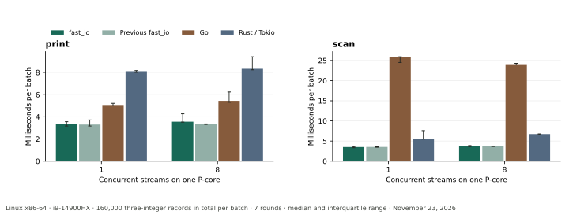

# fast_io

fast_io represents a cutting-edge input/output (I/O) library for C++20, designed to achieve [exceptional speed](readme.md#Benchmarks). Its primary purpose is to supersede the widely used `<iostream>` and `<cstdio>` libraries. This header-only library is distributed under the permissive [Anti-Tivo License](license.txt), simplifying integration into any project. However, its utilization mandates a C++20 compiler with support for concepts.

*Although the original fast_io repository has been archived due to accumulated git data, historical commits remain accessible.*
*Past commits were stored [here](https://bitbucket.org/ejsvifq_mabmip/fast_io_archive-2022-01-23).*

## Illustrations
### Output to `cstdout`
```cpp
#include <fast_io.h>

int main() 
{
	::fast_io::io::print("Hello, fast_io world!\n");
	::fast_io::io::print(::fast_io::c_stdout(), "Equivalent to the function above\n");
}
```
### Output to `native stdout` (Unbuffered)
* on non-windows systems (fd): (int)1
* on win32 (handle): GetStdHandle(STD_OUTPUT_HANDLE)
* on nt (handle): RtlGetCurrentPeb()->ProcessParameters->StandardOutput
```cpp
#include <fast_io.h>

int main() 
{
	::fast_io::io::print(::fast_io::out(), "Hello, fast_io world!\n");
}
```
### Memory-Mapped File
* Platforms that do not support memory mapping native_file_loader will read files into allocated space instead
```cpp
#include <fast_io.h>

int main() 
{
	::fast_io::native_file_loader file_data{"text.txt"};
	// file_data satisfies ::std::ranges::contiguous_range
}
```
### Scan from `cstdin`
```cpp
#include <fast_io.h>

int main() 
{
	int i;
	::fast_io::io::scan(i);
	// Equivalent to the function above
	::fast_io::io::scan(::fast_io::c_stdin(), i);
}
```
### Additional Samples

For up-to-date examples, refer to the [`examples/`](examples/) directories.

Outdated examples are retained [here](https://bitbucket.org/ejsvifq_mabmip/fast_io_deprecated)
though they might no longer be functional.

The i18n repository houses the i18n source files.

[https://bitbucket.org/ejsvifq_mabmip/fast_io_i18n](https://bitbucket.org/ejsvifq_mabmip/fast_io_i18n)

## F.A.Q.
### What does "fast" mean in fast_io?

The term ```fast``` within ```fast_io``` does not strictly denote the absolute fastest I/O library available (which might have prompted the name ```fastest_io```). Instead, it signifies that ```fast_io``` consistently surpasses the performance of both the ```<iostream>``` and ```<cstdio>``` libraries.

### What are the supported platforms, compilers...?

For a comprehensive list of supported elements and platform-specific usage instructions, consult [support.md](support.md).

### Have further questions?
You can ask questions on the [fast_io discord server](https://discord.gg/wYfh8kk)
or the QQ group: `801441303`.

## Documentation
Refer to either https://ewindy.gitee.io/fast_io_rst/index.html or https://gitee.com/qabeowjbtkwb/fast_io/wikis.

## Features
- Utilizing system calls directly, bypassing intermediary layers for enhanced efficiency.
- Embraces Unicode (UTF-8, UTF-16, UTF-32) with codecvt for GB18030 and UTF-EBCDIC (as these aren't properly addressed by libcs).
- Implements RAII for C `FILE*`, POSIX `fd`, and win32/NT `HANDLE`.
- Facilitates interoperation with `<cstdio>` and `<iostream>`.
- Minimizes misuse potential, unlike `std::endl`.
- Employs static I/O manipulators in lieu of format strings.
- Offers optional locale support.
- Implements stateless I/O manipulation.
- Maintains consistent error handling, favoring `exceptions` as the sole error reporting mechanism (excluding `std::error_code`, `std::system_error`, and redundant bounds checking).
- Accommodates freestanding mode.
- Incorporates Address Sanitizer code for memory safety.
- Provides support for Dynamic Instrumentation.
- Supports POSIX iconv for transcoding.
- Provides binary serialization for trivially copyable types and standard containers.
- Integrates seamlessly with C++ containers (e.g., `std::vector<fast_io::obuf_file>` is valid).
- Supplies basic/Lua/Python/etc. formatting (print, scan), omitting C and C++ due to security concerns.
- Native Handle Interface
- Exposes APIs for the internal implementation of `FILE*` and C++ streams.
- Abstains from using traits_type and EOF.
- Encompasses Dynamic Type Support
- Facilitates Multi-Process functionality
- Supports memory mapping
- Features debugging I/O (with optional GUI)
- Employs a round-trip floating-point algorithm
- Supports hash algorithms: intrinsic SHA-1, intrinsic HMAC-SHA1, intrinsic SHA-256, intrinsic HMAC-SHA256, SHA-512, HMAC-SHA512, as well as non-crypto hash algorithms like Jenkins Hash.
- Provides zlib compression/decompression
- Offers Filesystem capabilities
- OpenSSL BIO, Qt QFile, MFC CFile support

### Post C++20
  1. Module support
  2. Coroutine support for asynchronous I/O
  3. Code improvement and refactoring following the integration of [Zero-overhead deterministic exceptions](http://www.open-std.org/jtc1/sc22/wg21/docs/papers/2018/p0709r0.pdf) into the standard

## Benchmarks

On an Intel Core i9-14900HX, one buffered file stream processed 47.77 million three-integer records/s with marked `print` and 45.55 million with marked `scan`. The same run measured Go at 31.60 and 6.20 million, and Rust/Tokio at 19.74 and 28.54 million. The previous fast_io snapshot reached 48.48 and 45.29 million. The linked report includes submission latency, issuer CPU time, completion time and eight-stream measurements. [Linux results and measurement boundaries](documents/benchmarks/linux-native-20261123/README.md)



A returning conversion with an observed coroutine suspension took 116.16 core cycles and 21.90 ns in fast_io. A pinned Rust future took 119.33 cycles and 21.86 ns. A fresh-process 8 MiB ext4 copy reached 5.510 GiB/s in fast_io async and 5.366 GiB/s in Go on one lane. The eight-lane ordering changed between two independent windows. [Observed conversion](documents/benchmarks/linux-native-20261123/conversion.svg) · [File transfer](documents/benchmarks/linux-native-20261123/ext4.svg) · [UTF decoration](documents/benchmarks/linux-native-20261123/utf.svg) · [AES-GCM print and scan](documents/benchmarks/linux-native-20261123/aes.svg) · [Additional runtimes](documents/benchmarks/linux-native-20261123/runtimes.svg)

## Credits

The creation and development of this project were made possible thanks to the valuable contributions of various open-source projects. While the code was not copied directly from these projects, I used them as references and re-implemented them to suit the specific purposes of this library. In some cases, integration issues arose that required modifications to the original code. I am grateful to these projects and their developers for their commitment to making their code open and accessible to the wider community.

|Project          | Url
|-----------------|-----------------------------------------
|Grisu-Exact      |https://github.com/jk-jeon/Grisu-Exact
|Ryu              |https://github.com/ulfjack/ryu
|SHA-Intrinsics   |https://github.com/noloader/SHA-Intrinsics
|SHA1             |https://github.com/vog/sha1
|UTF-utils        |https://github.com/BobSteagall/utf_utils
|jenkins-hash-java|https://github.com/vkandy/jenkins-hash-java
|md5              |https://github.com/JieweiWei/md5
|ReactOS          |https://github.com/reactos/reactos
|dirent_h         |https://github.com/win32ports/dirent_h
|GNU C library    |https://www.gnu.org/software/libc/
|GNU Newlib       |https://sourceware.org/newlib/
|Dragonbox        |https://github.com/jk-jeon/dragonbox
|JEAIII           |https://github.com/jeaiii/itoa
|Crypto++         |https://github.com/weidai11/cryptopp
|MyItoA           |https://gitee.com/xjkp2283572185/MyStd
